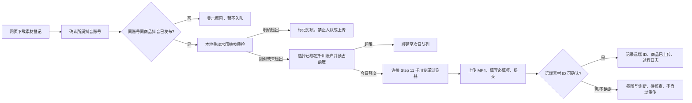

# Step 17 · 千川素材上传（FR-C3-01）

状态：本地源码和隔离测试已完成；2026-11-04 已补提交前自动重试与独立开关。2026-11-07 账号 4、商品 `3823892972466995628` 的 12 个上传任务成功，得到 10 个不同的远端素材 ID；其中 3 个任务指向同一远端 ID，因此以不同远端素材数计量。补足过程包含手动下载和手动入队，新版本“发布后自动补满 10 条”尚待另一个新商品实机验收；断网验收、重启后客户端调度验收也仍待做。此前队列 #42 的旧素材 #56/#57 为 `detail_generated`，不计入本次上传验收。

2026-11-07 自动补位增补：发布后任务保存「等待上传与核对／自动补位中／候选耗尽／不同素材达标」状态，定时按远端不同素材 ID 调和。千川合并重复上传时，重新从原百应账号获取未用视频；结果不明任务仍占槽位，不能盲目重复上传。后台每次最多读取一条成功素材的审核与评估并写回，同一远端 ID 的本地任务同步更新。新商品实机验收未完成，页面「不同远端素材」也不等于「审核通过」。

Step 16–19 与发布后自动编排的完整真实验收顺序及记录表见 [真实发布全链路验收流程](真实发布全链路验收流程-2026-11-06.md)。

## 操作流程

进入「素材与工具」可按账号筛选、切换全部/按账号分组，并对网页下载但账号未知的素材批量确认归属。旧素材缺少可靠来源记录时，只有操作人核对文件后才能用「确认旧素材网页来源」明确登记；详情图生成来源不能被此操作覆盖。进入「千川管理」选择抖音账号及其已绑定的千川账户，勾选单条或多条合格素材并入队。今日额度内的任务顺序执行；次日到期任务在源码客户端运行时自动续，页面也保留「执行到期任务」。登录或验证码由人员在 Step 11 专属浏览器处理，程序不读取账号密码，也不绕过验证。

“千川素材补发”包含原任务补发与成功后新增素材两类。原任务因配额或离线而顺延，或确认在平台文件选择前失败时按同一任务自动重试，默认开启，最多 3 次，间隔依次为 5、15、60 分钟；各次尝试、预计时间和原因保留在任务与事件日志。登录失效、验证码或权限不足等待人员处理，不消耗自动重试次数。关闭自动重试会停止已排队的重试，但不影响配额顺延和离线续行。文件选择开始后即按可能触及远端写入处理，提交结果不明时待核查且不自动重传。成功满 24 小时后的新增素材属于 FR-C11-01 / Step 33，规则与验收提示词见 `docs/提示词手册.md` 9.3；本次未实现 Step 33，不计入 Step 17 的实机验收结论。

## 资格与配额

- 只有 `source_type=web_download`、账号 ID 和商品 ID 已确认、文件存在，且 `publish_queue.platform_status=published` 的同账号同商品素材可入队。详情图生成素材单独标记，不能混入千川上传。
- 入队前与真正领取上传任务时，按本地 MP4 的文件大小、修改时间及检测规则版本核对移动水印质检结果。多帧 OCR 明确识别到持续移动的斜向文字水印时，素材标为「劣质」并拦截；已入队任务记为「劣质·已拦截」，不打开上传浏览器且释放额度。疑似或未能确认的结果继续按原流程上传。质检结果按素材和文件版本缓存；文件变化会重新检测。此规则针对能高置信识别的**移动文字**，不保证检出所有移动图形或水平文字；「未检出」也不等于无水印。平台的「搬运」判定有多种可能原因，本地质检结果不能直接解释为平台判定原因。
- 每品 ≤10 条；每账号每日 ≤5 品、≤50 条；每五账号组每日 ≤25 品、≤250 条。管理员可在「千川管理」调整账号额度、并发上限与步骤随机间隔；默认并发 1、间隔 800–2000 毫秒。
- 队列通过同一 SQLite 文件的 `BEGIN IMMEDIATE` 原子预占。提交前确认失败先释放当日额度；若自动重试开启且未到 3 次上限，同一事务按当前额度重新预占原任务，并持久化下次重试时间；其他情况保持失败，供人工处理。提交后结果不明保留额度并隔离。人工在千川确认素材已存在时补录远端 ID；确认确实不存在时写核查依据后重新按额度排队。重启后超过 30 分钟的遗留上传中任务转待核查。
- **多电脑边界**：本地 SQLite 仅保证同一数据库内的配额与状态互斥；20 台电脑各自保存数据库时不能保证全局五账号组额度。跨机正式使用前须接共享原子额度登记服务，或确保所有上传任务在同一数据库/执行端排队。当前界面会明确显示这一范围。

## 浏览器与官方 API 路线

当前使用浏览器自动化：复用 Step 11 的 `qianchuan-{千川账户数据库行 ID}` 独立 Chrome profile，核对 CDP 端口、页面登录态及唯一上传控件；在提交后必须回读明确的远端素材 ID，否则记待核查。每次失败保存截图和 JSON 诊断到客户端数据目录 `data/diagnostics/qianchuan-upload/`，阶段结果写 `qianchuan_upload_events`。

官方 API 仅在甲方获得开放平台应用、相应素材上传权限和目标千川账户授权后接入：按 SRS 附录 H 完成开发者认证、创建应用与回调地址、申请实际所需 scope、由账户管理人 OAuth 授权并安全保存/轮换 token；在官方文档核实**该账户类型可用的上传接口**与素材 ID 回读后，把 API 执行器接到同一队列 `claim → complete/fail`。目前未取得这些凭证，因此没有伪造 API 上传实现。开放平台当前公开的[千川素材库视频查询接口](https://open.oceanengine.com/tools/visual_debug.html?docId=1739309912219663)只证明查询能力，不能当作上传接口。

## 验收与证据

2026-11-07 实页验证：商品 3851141333951578946 的网页下载素材 #89、#90 分别上传到广告主 1878909235499335。千川视频库回读 ID 分别为 7702644223451627561、7702637375117262889，本机上传任务 #1、#2 均为 `succeeded`。上传执行器新增同名素材预检、弹窗内文件选择、长视频等待和按完整文件名回查，避免超时后重复上传。该次通过的是实际上传与远端 ID 核对；客户端更新后须重启再验收界面及后台调度。

2026-11-07 新批次 `a9c6d889-2168-45ac-9b1d-69795887c9c8` 实测：账号 4 自动为商品 `3640277561734501206` 加车，下载任务只找到 5 条同款作品并取得 5 个不同内容文件，状态为 `exhausted`（目标 10）。抖音发布队列 #48 的平台状态为 `published`，5 条素材经过本地移动水印质检后自动入 Step 17。千川任务 #15–#17 成功且各有不同远端素材 ID；#18 在文件选择后的等待阶段超时，标为 `needs_review`，不能自动重传；#19 保留在队列，账户自动上传暂停。对 #18 两次按完整文件名搜索未找到素材，同时成功任务 #17 的同一搜索方式能正确回读远端 ID；仍不足以证明 #18 永远不会延迟入库，需人工最终核查。用户已确认：同款作品少于账号额度时，继续发布并上传已找到的全部视频，同时明确标记缺额。发布后缺额状态会在上传任务状态变化后重新对账，显示已确认远端数量及待处理/待核查数量；不得把 5 条显示为 10 条完成。

视频库「审核状态」与「素材评估」是两个独立字段，上传成功不表示审核通过。客户端已提供单条任务「刷新平台判定」，通过账号专属浏览器按远端素材 ID 精确搜索后写回本机；页面显示 `-` 时界面标记「平台未显示」，不能当作通过。2026-11-07 实页回读：任务 #1 两栏均为 `-`；任务 #2 审核状态为 `-`，素材评估为「搬运」。平台判定可能继续变化，使用前应刷新；本功能只读取和展示，不自动申诉或删除。

移动文字水印质检是在上述两条真实上传**之后**加入的本地闸门；对素材 #90 的本地复核为「劣质」，对 #89 为「未确认」。历史上传和平台「搬运」状态仍保留，不会自动撤回或删除远端素材。新入队及尚未执行的任务按新闸门拦截。

初始隔离测试日志：`D:\software\投广客户端\小g工作区\verify-step17-qianchuan-upload-20261101\`。2026-11-04 提交前自动重试补充后，队列与浏览器隔离测试共 26 项通过，桌面端 `typecheck` 与 `build` 通过；验证了迁移保留旧任务、5/15/60 分钟间隔、三次上限、人工闸门与结果不明不重试、关闭开关取消等待中的重试。

真实验收按提示词进行：先完成同账号同商品抖音发布确认，在专属千川浏览器保持登录，用 1 个千川账户上传 2 条已标明网页下载来源的素材；核对页面、队列状态与远端素材 ID。再故意断网 1 次，核对截图、诊断 JSON 和过程日志。真实千川 DOM 未取得前，控件选择器与远端 ID 回读仍需此轮校准，不能以静态测试宣称验收通过。
