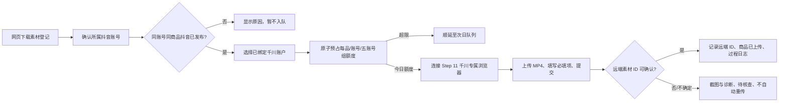

# Step 17 · 千川素材上传（FR-C3-01）

状态：本地源码和隔离测试已完成；2026-11-04 已补提交前自动重试与独立开关的源码实现。真实千川页面的 1 个账户、2 条素材及断网验收待做。此前队列 #42 有一次抖音 `published` 回执，但关联素材 #56/#57 为 `detail_generated` 且账号 4 当时无千川绑定；它不能直接证明 Step 17 上传准入或真实上传通过。已有新的上传成功反馈时，按下述操作单先核对账号、商品、素材来源和远端 ID。

Step 16–19 与发布后自动编排的完整真实验收顺序及记录表见 [真实发布全链路验收流程](真实发布全链路验收流程-2026-11-06.md)。

## 操作流程

进入「素材与工具」可按账号筛选、切换全部/按账号分组，并对网页下载但账号未知的素材批量确认归属。旧素材缺少可靠来源记录时，只有操作人核对文件后才能用「确认旧素材网页来源」明确登记；详情图生成来源不能被此操作覆盖。进入「千川管理」选择抖音账号及其已绑定的千川账户，勾选单条或多条合格素材并入队。今日额度内的任务顺序执行；次日到期任务在源码客户端运行时自动续，页面也保留「执行到期任务」。登录或验证码由人员在 Step 11 专属浏览器处理，程序不读取账号密码，也不绕过验证。

“千川素材补发”包含原任务补发与成功后新增素材两类。原任务因配额或离线而顺延，或确认在平台文件选择前失败时按同一任务自动重试，默认开启，最多 3 次，间隔依次为 5、15、60 分钟；各次尝试、预计时间和原因保留在任务与事件日志。登录失效、验证码或权限不足等待人员处理，不消耗自动重试次数。关闭自动重试会停止已排队的重试，但不影响配额顺延和离线续行。文件选择开始后即按可能触及远端写入处理，提交结果不明时待核查且不自动重传。成功满 24 小时后的新增素材属于 FR-C11-01 / Step 33，规则与验收提示词见 `docs/提示词手册.md` 9.3；本次未实现 Step 33，不计入 Step 17 的实机验收结论。

## 资格与配额

- 只有 `source_type=web_download`、账号 ID 和商品 ID 已确认、文件存在，且 `publish_queue.platform_status=published` 的同账号同商品素材可入队。详情图生成素材单独标记，不能混入千川上传。
- 每品 ≤10 条；每账号每日 ≤5 品、≤50 条；每五账号组每日 ≤25 品、≤250 条。管理员可在「千川管理」调整账号额度、并发上限与步骤随机间隔；默认并发 1、间隔 800–2000 毫秒。
- 队列通过同一 SQLite 文件的 `BEGIN IMMEDIATE` 原子预占。提交前确认失败先释放当日额度；若自动重试开启且未到 3 次上限，同一事务按当前额度重新预占原任务，并持久化下次重试时间；其他情况保持失败，供人工处理。提交后结果不明保留额度并隔离。人工在千川确认素材已存在时补录远端 ID；确认确实不存在时写核查依据后重新按额度排队。重启后超过 30 分钟的遗留上传中任务转待核查。
- **多电脑边界**：本地 SQLite 仅保证同一数据库内的配额与状态互斥；20 台电脑各自保存数据库时不能保证全局五账号组额度。跨机正式使用前须接共享原子额度登记服务，或确保所有上传任务在同一数据库/执行端排队。当前界面会明确显示这一范围。

## 浏览器与官方 API 路线

当前使用浏览器自动化：复用 Step 11 的 `qianchuan-{千川账户数据库行 ID}` 独立 Chrome profile，核对 CDP 端口、页面登录态及唯一上传控件；在提交后必须回读明确的远端素材 ID，否则记待核查。每次失败保存截图和 JSON 诊断到客户端数据目录 `data/diagnostics/qianchuan-upload/`，阶段结果写 `qianchuan_upload_events`。

官方 API 仅在甲方获得开放平台应用、相应素材上传权限和目标千川账户授权后接入：按 SRS 附录 H 完成开发者认证、创建应用与回调地址、申请实际所需 scope、由账户管理人 OAuth 授权并安全保存/轮换 token；在官方文档核实**该账户类型可用的上传接口**与素材 ID 回读后，把 API 执行器接到同一队列 `claim → complete/fail`。目前未取得这些凭证，因此没有伪造 API 上传实现。开放平台当前公开的[千川素材库视频查询接口](https://open.oceanengine.com/tools/visual_debug.html?docId=1739309912219663)只证明查询能力，不能当作上传接口。

## 验收与证据

初始隔离测试日志：`D:\software\投广客户端\小g工作区\verify-step17-qianchuan-upload-20261101\`。2026-11-04 提交前自动重试补充后，队列与浏览器隔离测试共 26 项通过，桌面端 `typecheck` 与 `build` 通过；验证了迁移保留旧任务、5/15/60 分钟间隔、三次上限、人工闸门与结果不明不重试、关闭开关取消等待中的重试。

真实验收按提示词进行：先完成同账号同商品抖音发布确认，在专属千川浏览器保持登录，用 1 个千川账户上传 2 条已标明网页下载来源的素材；核对页面、队列状态与远端素材 ID。再故意断网 1 次，核对截图、诊断 JSON 和过程日志。真实千川 DOM 未取得前，控件选择器与远端 ID 回读仍需此轮校准，不能以静态测试宣称验收通过。
