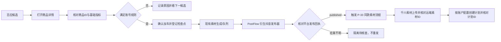

# B 电脑交接方案：PostFlow 深度接入抖音发布执行器

日期：2026-11-12
状态：方案文档已准备；未改业务代码、未做平台操作、未执行测试。
交接状态：本方案仅为实施说明；不代表代码改造、测试或真实平台验收已完成。

## 1. 目标

改善“百应选品 → 商品详情核验 → 加车 → 抖音作品发布 → 同款素材下载 → 千川素材上传/计划”的可靠性。PostFlow 深入参与抖音创作者中心的作品发布执行；投广客户端继续负责账号、商品规则、任务账本、恢复、防重和千川编排。

本方案针对近期两个明确问题：

1. 实际选品时没有可靠地进入每个商品详情并核对基础数据，就可能继续加车。详情核验必须成为加车前的硬闸门。
2. 多账号任务不应同时打开七个账号的百应/创作者中心窗口。账号与浏览器必须逐个处理，单账号完成后再关闭或释放其窗口并启动下一账号。

本方案不把 PostFlow 当成完整业务系统，也不把它的成功日志直接等同于抖音或千川平台回执。

## 2. 开工基线与已锁定口径

### 2.1 项目文档基线

开工时项目 `docs/TODO.md` 标注最后更新为 2026-11-06，列有 14 组待验收/待复核事项。表内明确：

- Step 16 抖音自动发布仍须用新任务核验真实字段、商品关联、最终提交和平台回执；禁止处理旧待核查队列 #38、#39；已发布 #42 不得改作定时任务。
- Step 17 千川素材上传仍须核验真实 `web_download` MP4 和远端素材 ID。
- P-33 发布后下载并上传千川仅有静态/隔离证据，真实端到端仍待验收。

该 TODO 快照早于本方案日期。B 开工前必须重新读取当前 `docs/TODO.md` 当前待验收总表、最新变更日志、`docs/决策先例.md` 及当前工作区未提交改动；不得把本方案中的历史基线冒充最新进度。

### 2.2 保持不变的用户口径

- 旧任务 #38、#39 不得碰、不恢复、不重试；已发布 #42 不得复用为定时任务。
- P-33 的千川素材获取触发点是抖音作品确认 `published` 之后；不得改成加车后提前下载，也不得把 `submitted_review` 当成已发布。
- 商品详情必须先按商品 ID 精确匹配，再检查当前配置要求的基础数据；数据缺失、ID 不一致、详情未成功打开，均不得加车。
- 移动水印只有“明确检出”才按已确认规则拦截；疑似不能擅自升级成拦截条件。
- 多账号串行处理；不得同时启动所有账号浏览器。
- 账号日预算只能读取该千川账户已保存的配置；不能把某个账号确认过的 50 元自动套给其他账号。预算缺失时暂停计划创建并说明原因。
- 不绕过登录、扫码、验证码、平台权限或风控；不记录 App Secret、Token、Cookie、授权码或完整回调 URL。
- 本轮只交方案，不执行真实选品、加车、发布、上传素材或创建/投放千川计划。

## 3. PostFlow 源码评估结论

参考项目：

- 仓库：<https://github.com/jefftko/PostFlow>
- 抖音发布器：<https://github.com/jefftko/PostFlow/blob/main/uploader/douyin_uploader/main.py>
- 发布指南：<https://github.com/jefftko/PostFlow/blob/main/docs/PUBLISH_GUIDE.md>
- 示例：<https://github.com/jefftko/PostFlow/blob/main/examples/upload_video_to_douyin.py>
- 许可证：仓库提供 MIT LICENSE；若采用代码，保留原版权和许可证文本，并记录上游版本/提交。

当前可借鉴的功能：

- `DouYinVideo` 输入包括标题、视频路径、话题、描述、商品链接和商品标题；代码包含购物车商品链接和商品短标题的填写逻辑。
- 有发布前截图辅助调试，按页面状态等待上传、填写与发布步骤。
- 对平台页面变化有较多兼容逻辑，可作为创作者中心 DOM/弹窗问题的参考。

不可直接照搬的差异：

- PostFlow 当前实现会自行启动 Chromium、创建新 BrowserContext，并用 `account_file` 作为 Playwright `storage_state`。客户端已有按账号隔离的托管浏览器资料，不能再建立第二套 Cookie 文件/账号状态。
- PostFlow 的公开 `main()` 目前主要执行上传流程；不能把它返回/日志视作客户端需要的结构化队列回执。
- 它的提交确认包含 URL/按钮变化等页面判断。投广客户端必须在提交后核对本次账号、作品/任务、商品和平台状态；仅按钮消失或页面跳转不能单独证明发布成功。
- PostFlow 不负责百应选品详情闸门，也不负责千川素材库与千川计划创建。
- 上游主页持续变动；B 必须先固定审查的上游提交，并核对代码和许可证，不得直接跟随未来 `main` 漂移。

## 4. 总体结构



责任边界：

| 模块 | 责任 | 不能代替的责任 |
|---|---|---|
| 百应选品 | 候选读取、详情页核验、指标规则、加车与商品检查点 | 不能使用旧候选列表数据冒充详情实查 |
| PostFlow 衍生发布器 | 创作者中心页面操作：上传、标题/描述、商品挂车、短标题、提交前核验 | 不拥有账号账本、任务状态和防重主键；不创建千川计划 |
| Electron 主进程与现有数据库 | 账号串行调度、发布队列、锁、检查点、事件与恢复 | 不把 UI 点击动作单独当成平台成功回执 |
| 千川模块 | 同商品素材检索/上传、远端素材核对、计划创建/回执 | 上传成功不等于计划已创建或投放成功 |

## 5. 接入设计

### 5.1 PostFlow 只作为发布页面适配器

建议抽取/改造 PostFlow 抖音发布流程，适配当前 Python 伴生引擎。禁止整体复制 PostFlow 的前端、服务端、Cookie 目录或独立账号管理。

适配器应接收客户端已经打开的、属于目标账号的浏览器会话或页面对象；优先复用现有 `engine/browser_cdp.py` / Electron 引擎桥接能力。不得在适配器内部再 `launch()` 一个新 Chrome，不得调用 PostFlow `cookie_auth`、`douyin_setup` 去创建第二份账号登录态。若现有会话无法安全接入，先停下报告原因及拟改接口，不得偷偷退回另开浏览器。

建议接口契约（字段名供实现时按现有 IPC/类型约定调整）：

```text
preparePublish(taskId, accountId, productId, videoPath, title,
               description, productLink, productShortTitle, publishMode)
  -> { status, stage, verifiedFields, screenshotPath, errorCode, reason }

submitPublish(taskId)
  -> { status, submitAttempted, platformStatus, awemeId, workUrl,
       screenshotPath, errorCode, reason }
```

规则：

- `preparePublish` 只能填写并验证，不能点最终“发布”。
- 调用 `submitPublish` 前，由队列原子认领同一任务并再次检查账号、商品、视频、标题、挂车商品和短标题。
- 最终提交按钮最多点击一次。点击后无确定回执，记为结果不明并隔离，不自动再点。
- 适配器返回结构化结果；现有发布队列仍是唯一状态源，适配器不得另建发布数据库。
- 日志只写 taskId、账号内部 ID、商品 ID、步骤、结果码和脱敏诊断；不写凭证、Cookie 或敏感请求头。

### 5.2 商品详情必查闸门

每一个候选商品按如下步骤执行：

1. 保存候选商品 ID 与来源、候选排序、当前账号 ID。
2. 打开候选对应详情页，等待页面稳定和详情请求完成；等待必须有上限，不能用固定长 `sleep` 作为成功依据。
3. 从详情页 URL/页面数据/响应中至少取得可核验的商品 ID，并与候选 ID 精确相等。商品标题只能作诊断信息，不能替代 ID。
4. 读取账号规则要求的基础指标、走势/趋势和采集时间。对缺失指标明确记 `missing`，不可用模型猜值或列表旧值补齐。
5. 按保存的账号个性化条件做硬门槛；只有全部必需指标可判定且通过，才能执行加车。
6. 将原始可审计数值、规则版本、达标/淘汰决定和原因写入选品事件。
7. 详情页打开失败、商品 ID 不一致、指标读取不完整或页面状态不稳定：跳过该候选或将本账号停在可恢复状态；绝不直接加车。

禁止把“候选初筛通过”“预览勾选”“页面标题出现”写成“详情核验通过”。

### 5.3 发布状态、回执和防重复

实现前先核对现有 `publish_queue` 状态和事件，不新增第二套状态模型。目标阶段至少能区分：排队、准备中、已上传待提交、提交中、已提交待审核、已发布、明确失败、结果不明待核查、人工阻塞。

关键规则：

- 同一发布任务/账号/商品/视频只允许一个 active claim；队列重启后按检查点恢复。
- 准备阶段失败且有证据表明未提交，才可按原任务安全重试。
- 最终提交点击后超时、进程退出、页面断开或回执不清晰，一律结果不明；先查平台作品记录，不重传、不重新关联、不再次点击发布。
- `published` 必须有平台作品记录或可靠的页面回执，且与队列账号、商品及本次作品吻合。`submitted_review` 单独记录，不触发 P-33。
- 平台查到已有本次作品时，补记作品 ID/URL 和回执，不新建重复作品。
- 防重复范围应结合批次 ID、账号 ID、商品 ID、视频内容指纹/文件哈希和平台作品 ID；永久屏蔽同商品不符合业务需求，必须由当前业务规则决定去重范围。

### 5.4 多账号浏览器生命周期

每一时刻最多由本轮自动流程持有一个正在操作的账号浏览器：

1. 选定账号并检查其专属登录态、配置、下载目录和队列边界。
2. 只打开该账号需要的百应/创作者中心页面；复用其隔离 profile。
3. 该账号商品详情、加车、素材准备、抖音发布和必要的发布后异步任务到达可安全挂起/完成点后，保存检查点并关闭或释放自动化窗口。
4. 再启动下一个账号。登录、扫码或验证码阻塞时保留该账号原因与检查点；不得绕过平台验证。只有确认资源释放后才轮转。
5. 应用重启从持久队列恢复，不依赖仍然打开的七组网页。

多个任务共用同一千川档案时，千川侧也要按千川账户锁串行，避免两个账号并发操作同一个广告主资料。

### 5.5 千川素材与计划分离

这不是 PostFlow 的职责，保留现有千川上传模块并核对它和计划模块是否接完整：

1. 素材来源必须是同账号、同商品、合格的网页下载视频；按账号/商品/内容指纹去重。
2. 一条素材上传只有在平台返回远端素材 ID 且本地队列确认关联正确时才算上传成功。
3. 计划创建使用该账户已保存的广告主、抖音号、商品、素材 ID 和账户级预算；预算未配置、身份不唯一、素材 ID 不明确时停止。
4. 每个计划任务有独立提交前、提交中、待核查、已创建、失败状态。提交结果不明先查千川计划列表，不重复创建。
5. 页面或 API 只能证明“素材上传”，不能把状态显示为“计划已发布”。计划创建成功需保存并回读计划 ID、广告主、商品、预算及平台状态。
6. 不改变 P-33 的触发边界：抖音 `published` 后才触发发布后下载/上传；额度不足按现有配置延后，不修改用户设定的额度。

## 6. B 电脑实施步骤

各阶段依次完成；一阶段未验收，不把后续阶段合并成大改动。

### 阶段 0：B 端开工核对（只读）

- 进入 `D:\抖音电商\投广管理客户端`，先读 TODO 当前待验收总表、最新变更日志、决策先例和本方案。
- 查看当前分支、所有 worktree、未提交变更和目标文件归属；不清理、不覆盖、不 stash。
- 确认主工作区和 B 的最新代码基线；TODO 当前表日期与源代码有差异时，先汇报差异，不能在旧快照上改代码。
- 对 PostFlow 固定一个具体上游提交 SHA，核实 MIT LICENSE、依赖许可、实际 DouYinVideo 商品挂车实现和测试。不要只凭 `main` README 确认兼容。
- 形成拟改文件清单及逐文件理由，发主对话等用户确认；确认前不写代码、不装依赖、不运行平台操作。

### 阶段 1：PostFlow 适配器设计与隔离准备

- 只实现一个窄的 Douyin 页面适配器，接收现有会话/页面；剥离 PostFlow 自己的 Chrome launch、Cookie storage_state、账号登录和调度部分。
- 复用现有 SQLite 发布队列和 Electron 主进程锁；不新建用户/任务数据库。
- 给页面动作定义稳定的步骤结果、失败类型、截图位置及字段回读；截图不得含凭证，保存到诊断目录并受现有保留策略约束。
- 先用本地 DOM fixture/模拟对象验证“prepare 不提交、submit 最多点击一次、未知结果隔离”。此级别只可报告“隔离通过”。

### 阶段 2：商品详情必查闸门

- 先从实际执行入口追踪候选对象如何流入详情核验，再核对详情指标规则和加车调用点。
- 将“详情商品 ID 精确匹配 + 必需基础指标读取 + 账号规则通过”做成唯一加车前置条件。
- 保存每个商品的详情读取证据和淘汰原因；每个失败候选不应阻止后续候选，但登录/验证码/权限/批次级故障按已有分类处理。
- 通过静态和隔离验证后，等待用户明确提供/确认实机测试范围；本方案执行者不自动登录或加车。

### 阶段 3：接入抖音准备与发布回执

- 将现有自动发布页面步骤逐项映射到 PostFlow：选文件、等上传结束、填写作品标题/描述、挂商品链接、填商品短标题、按现有用户决定跳过封面、最终字段回读。
- 先交付 `prepare-only`；确认字段后，再实现独立的 `submit-once` 和平台回执读取。
- 保留现有标题清理及长度校验；商品链接解析出的商品 ID 必须等于队列 productId；短标题必须不超过当前平台和用户规则限制。
- 通过隔离验收后另列本机真实浏览器验收申请。平台端到端发布须有当轮账号/商品/最终提交范围确认，不碰 #38、#39，不复用 #42。

### 阶段 4：逐账号调度与恢复

- 复用现有 sequential scheduler，而不是让 PostFlow 自己启动多浏览器。
- 以一个账号完成/暂停为轮转单位；每次轮转前验证页面/profile 释放，写入检查点。
- 覆盖客户端重启、账号 1 失败转账号 2、登录/验证码阻塞、限流冷却、单商品无库存跳过和一个商品发布结果不明等故障边界。
- 结果不明不得自动重试；登录/验证码/权限不足停在该账号，不绕过，后续账号是否继续按现有明确规则处理。

### 阶段 5：千川链路和全流程验收

- 先核对本地千川账户绑定、登录状态、授权范围、关联抖音号和账户级预算配置。
- 分开验收素材上传 ID 与计划创建 ID；先素材，再单个计划，再补发/额度延后。
- 未确认远端状态不得重复上传或创建计划；不调用未经核准的接口，不做任何实际花费/投放，除非用户另行明确确认账户和预算。
- 完整流程真实验收只使用新建专用任务和新商品；从详情核验记录一路对到抖音作品、千川远端素材和计划回执。

## 7. 建议检查的现有文件

以下是 B 的代码阅读地图，不是预先批准的修改清单。B 必须核实当前文件版本、调用关系和工作区归属，再提交确切改动清单：

| 领域 | 阅读入口（按当前仓库实际路径核对） | 关注点 |
|---|---|---|
| 百应选品/详情/加车 | `engine/browser_cdp.py`、`engine/selection_settings.py`、`desktop/src/renderer/src/components/SelectionSettingsView.vue` | 真实执行入口、详情身份校验、指标来源、加车之前是否硬性要求详情通过 |
| Electron 到引擎 | `desktop/src/main/engine.ts`、`desktop/src/main/auto_publisher.ts` | 浏览器会话生命周期、Python 命令参数、IPC 边界 |
| 发布和恢复 | `engine/publish_queue.py`、`engine/browser_cdp.py`、`desktop/src/main/publish_scheduler.ts` | 现有状态枚举、任务原子认领、结果不明隔离、平台回执来源 |
| 账号/浏览器 | `desktop/src/main/account_login.ts`、`desktop/src/main/external_browser.ts`、`desktop/src/main/baiying_batch.ts` | 每账号 profile、单浏览器轮转、释放时机及会话登录状态 |
| 千川素材/发布后编排 | `engine/qianchuan_upload.py`、`engine/qianchuan_browser.py`、`desktop/src/main/qianchuan_upload.ts`、`desktop/src/main/post_publish_qianchuan_material.ts` | 素材唯一 ID、提交不确定、P-33 published 触发、账户锁 |
| 测试与文档 | `engine/test_publish_step19.py`、`engine/test_qianchuan_upload.py`、相关 selection/publish 测试、`docs/TODO.md` | 现有测试可复用范围、测试级别和最新进度 |

不要为了“接入 PostFlow”一次性修改上表全部文件。每个阶段先限定变量，再按需缩小实际修改清单。

## 8. 验收矩阵与结论分级

| 用例 | 通过条件 | 结论级别 |
|---|---|---|
| 详情身份与指标门槛 | 候选 ID 与实际详情 ID 完全一致；基础指标被回读；不合格/缺失时没有加车调用；合格后才加车 | 隔离通过后再申请本机真实 |
| 发布准备 | 页面识别到对应视频；标题/短标题/商品链接字段回读与队列一致；没有最终提交 | 隔离通过 / 本机真实 |
| 发布一次性提交 | 最终按钮至多点击一次；明确成功后保存作品回执；超时后进入待核查，不再点击 | 平台端到端需创作者中心真实记录 |
| 重启恢复与防重 | 已完成任务重启后跳过；未提交任务从检查点续；提交结果不明任务不会自动重复发 | 隔离通过 + 本机真实 |
| 七账号顺序 | 自动化同时最多持有一个账号浏览器；前一账号检查点持久化后才启动下一账号；重启可续 | 本机真实；不能用 mock 称真实通过 |
| 千川素材 | 目标账户中能查到对应且唯一的远端素材 ID | 平台端到端 |
| 千川计划 | 回读计划 ID、账户、商品、预算和状态；结果不明不重复建计划 | 平台端到端，且需要单独明确预算/操作范围 |
| 全流程 | 同一新任务的详情、加车、抖音作品、素材和计划身份及状态首尾一致；无重复发布/重复计划 | 平台端到端 |

报告必须使用四级口径：静态通过、隔离通过、本机真实、平台端到端。禁止跨级或将“代码存在/按钮点击/上传素材”表述为完整发布成功。

## 9. B 电脑交付要求

每个阶段交付时必须提供：

1. 执行命令原文，可复制复现；
2. 命令实际输出关键行原文；
3. 证据文件的绝对路径；
4. 改动文件逐项清单、验证级别和未完成项；
5. 明确没有执行的真实平台操作。

遇同一错误连续两次仍失败立即停止，按“现象 / 已试方案 / 失败原因 / 需要什么”报告。发现不属于本方案的风险只列出，不顺手修。

## 10. 禁止事项

- 不触碰、不恢复、不重试队列 #38、#39；不把 #42 用作定时任务。
- 不推送 Git、不打包、不部署；不删数据库、浏览器资料、素材或下载文件。
- 不执行真实平台发布、素材上传、计划创建/投放或违规素材删除。
- 不绕过登录、扫码、验证码、权限、额度或平台风控。
- 不把本地 mock/隔离状态写成真实平台通过；不编造回执。
- 不提交或输出 App Secret、Token、Cookie、授权码及其他凭证。
- 未先读 TODO/决策记录、检查工作区与提交实际文件清单并等用户确认前，B 不开始写业务代码。

## 11. 可复制给 B 电脑的开工提示词

```text
请先读取项目 docs/TODO.md 的“当前待验收总表”和最新变更日志、docs/决策先例.md，以及 docs/交接-B电脑-PostFlow发布执行器接入方案-2026-11-12.md。不要先写代码。

先检查当前分支、所有 worktree、未提交改动和相关文件归属；特别确认 TODO 最新状态与方案中 2026-11-06 基线的差异。按方案第 7 节阅读现有选品详情闸门、发布队列、浏览器 profile、千川队列及 P-33 调用关系。固定审查的 PostFlow 上游提交，核对 MIT LICENSE 和商品挂车/短标题实现。

然后只回复：
1. 你确认的当前代码基线与进度差异；
2. PostFlow 适配可行性和不兼容点；
3. 第一阶段的确切修改文件清单及逐文件理由；
4. 将执行的静态/隔离验证和证据路径；
5. 当前需要用户决定的阻塞项。

等用户确认第一阶段文件清单后再写代码。按本方案阶段顺序推进，每阶段只改一个变量。严禁触碰队列 #38/#39，严禁复用 #42；不推送 Git、不打包、不部署、不删除资料；不做真实平台发布、千川上传或投放；不绕过验证码/登录；凭证不得写入日志或文档。每次交付提供命令原文、关键输出原文、证据绝对路径、改动文件清单和验证级别。
```
